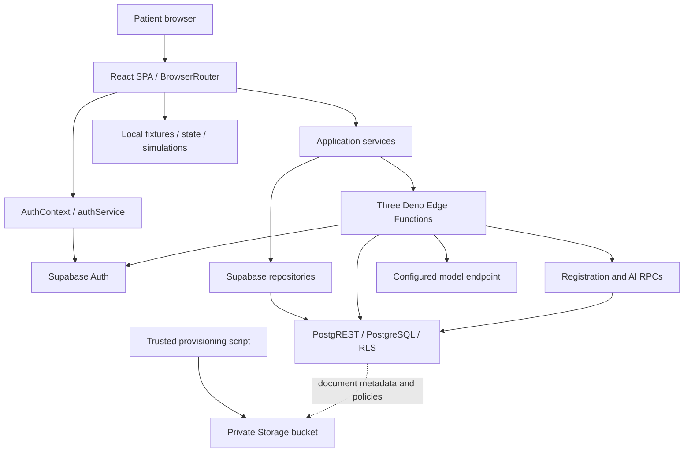

# EasyCare — complete current-state technical handoff

**Inspection date: 2026-10-03 (Asia/Rangoon). Documentation only.**

This report describes executable repository behavior, not the product vision. It distinguishes UI, runtime code, database enforcement, isolated tests and deployed evidence. The repository contains both genuine patient application paths and substantial demonstration UI. Nothing was deployed or repaired for this report.

Read this document first, then:

- [Frontend map](EASYCARE_FRONTEND_MAP.md): all routes, components, displayed data and simulations.
- [Backend map](EASYCARE_BACKEND_MAP.md): services, repository methods, authentication, all Edge Functions, AI, environment and deployment.
- [Database handoff](../supabase/database-v2-handoff.md): current ownership, table usage, relationships, Repairs 1–15, debt, query/index requirements and full migration list.
- [Final schema catalog](../supabase/database-v2-schema-map.md): exact cumulative columns, constraints, policies, functions, grants, indexes and triggers. Do not duplicate or reconstruct those hundreds of catalog entries from UI labels.

## 1. Executive current-state answers

1. **What is EasyCare today?** A React patient-facing SPA with Supabase Auth/PostgreSQL/RPC/Edge Functions, a real patient registration/login/profile/booking/read-dashboard foundation, an implemented AI overview architecture, and several explicitly simulated care experiences. No clinician/admin/family application is routed.
2. **What genuinely has an end-to-end implementation?** Registration → managed Auth → profile/patient/consents → password login → patient session → protected dashboard; provider/slot discovery → appointment insert → appointment read; patient settings read/update; medication read; database-context → validated/cached AI overview → dashboard. These are traced runtime paths with local test evidence, **not a claim that hosted browser journeys were exercised in this task**. They require configured Supabase, applied migrations, data and deployed functions; model output additionally requires model configuration.
3. **What only looks implemented through presentation data?** Health-record/prescription/lab screens, consultation queue/device checks, messaging, payments, care-package request wizard, subscription selection, contact submission, location/SOS simulation and password recovery. The AI Guardian also has deterministic fallback that can look functional when its backend is unavailable.
4. **Which backends lack frontend integration?** Clinical authoring, lab ordering/results ingestion, private document upload, medication occurrence generation and confirmation RPC, notification delivery/mark-read, family permissions management, coordinator request/assignment workflow, follow-ups, complaints and feedback.
5. **Which frontends lack backing services?** Package booking/subscription selection, message delivery, payment processing, media consultation, real recovery OTP/password reset, contact support submission and emergency dispatch. Cancellation/rescheduling backend methods exist but reference missing RPCs; current real-mode controls are hidden.
6. **Which foundations are strong?** The replayable schema, patient/provider identities, patient-scoped clinical relationships, Repairs 1–15, RLS helpers, medication chains, labs/documents, summary provenance/cache and substantial PostgreSQL security tests. This is a local foundation, not proof of production readiness.
7. **What major capabilities are missing?** Family Command Center and household/dependents, normalized Smart Care Plan/tasks/progress, full Health Story, request-to-care orchestration, durable/family-aware AI chat, health goals, encounter diagnoses/procedures, devices, real messaging and payments.
8. **Current AI capability?** Two distinct implementations: patient-record AI Overview with context/safety/cache/persistence; symptom-text Guardian with safety/gateway but a missing rate-limit RPC. Provider matching is not an implemented AI workflow.
9. **Current family capability?** Delegated database authorization exists; no usable family-management/dashboard/login product. `/families` is public marketing.
10. **Current care-plan capability?** Encounter text, subscription-derived dashboard label, local home-care package wizard, medication schedules and follow-ups are separate concepts. No normalized clinical plan/task/progress product.
11. **Deployment readiness?** Vite build configuration and a Vercel SPA rewrite exist; Supabase functions/config/migrations/scripts exist. No Cloudflare config, verified deployment, hosted schema audit, live Storage transfer or live model validation is established here.
12. **What must never be recreated accidentally?** Existing identities, all health tables already present, summary/cache infrastructure, safety layers, repository abstraction, and Security Repairs 1–15. Extend only under a specific approved scope.

## 2. Evidence, totals and counting rules

| Item | Verified current state |
|---|---|
| Named route patterns | **28**, including `/`; **29** if wildcard not-found route is counted; layout-only wrappers excluded |
| Edge Functions | **3** deployable directories with `index.ts`; `_shared` is not an endpoint |
| Public tables / migrations / FKs | **48 / 44 / 113**, from the immediately preceding clean catalog replay; current migration filenames/count reconfirmed |
| RLS policies | **102 public + 6 Storage** |
| Non-legacy tests | Fresh result recorded in section 15; prior baseline **987 tests / 67 files** |
| Real-data capability groups | **10 (R1–R10 below)**; some partial and deployment-unverified, not ten independently certified products |
| Mock/presentation capability groups | **11 (M1–M11 below)**; excludes static marketing pages, decorative assets and individual buttons |
| Broken backend object references | **8 distinct missing objects**: five tables and three RPCs; two reachable in current paths, six latent/guarded adapters |

**R1–R10:** registration; login/session/logout; patient profile settings; doctor discovery/details; availability; appointment creation; appointment list/detail reads; medication list/today reads; dashboard overview/provider/subscription reads; AI Health Overview pipeline. Splitting or combining these differently changes the count; this explicit list is the counting basis.

**M1–M11:** password-recovery flow; health-record screen; prescription screen; lab-result screen; consultation simulation; home-care package wizard; subscription selection; payment/invoice screen; messages; location/SOS; contact submission. Some have real database support elsewhere, but these user-facing experiences do not persist their represented workflow. Static public marketing pages are not counted as health features.

**Evidence limits:** Source and import tracing plus local automated tests; no live browser session, hosted Auth/RLS/grants, real provider catalog, real payment, AI provider call, media call or Storage transfer verified. No package installation, build-output rewrite, migration, config or code change was performed. Existing generated `dist/` is not evidence that it matches current source. Existing design DOCX/PNG/Mermaid artifacts are historical design materials, not runtime contracts.

## 3. Current architecture and stack

Lockfile versions are more precise than the semver ranges in package.json:

| Layer | Current implementation |
|---|---|
| Frontend | React/react-dom **19.2.8** locked; package requests `^19.1.1`; JavaScript/JSX ES modules |
| Build | Vite **6.4.3** locked; `@vitejs/plugin-react`; scripts dev/build/preview/test |
| Routing | react-router-dom **7.18.2**, BrowserRouter + declarative Routes |
| Styling | One large handwritten `src/styles/global.css`, CSS grid/flex/media queries; no Tailwind/MUI component system |
| Icons | lucide-react; images and portrait sprites in public/ |
| State | React state/effects; AuthContext and LocalizationContext; localStorage for demo/session uses and sessionStorage for language |
| Fetching | Supabase SDK **2.109.0**, direct async service/repository calls; TanStack Query **5.101.4** provider mounted but no runtime useQuery/useMutation found |
| Validation | Zod **4.4.3** locked in browser; Edge imports `npm:zod@4.0.17`; tests alias that import to installed zod; hand-coded validation also exists |
| Backend | Supabase PostgREST/Auth/PostgreSQL RPC plus **Deno Edge Functions**; no Express/Nest/Django/FastAPI/custom Node API found |
| Database | PostgreSQL migrations, enums/checks/FKs/triggers/RLS and SECURITY DEFINER helpers |
| Storage | Private clinical-documents metadata/policies and provisioning script; no complete frontend file workflow |
| AI | Shared OpenAI-compatible HTTP adapter, contract/safety layers; separate Overview and Guardian paths |
| Tests | Vitest **3.2.7**, Testing Library/jsdom, PGlite **0.5.8**, injected provider/network dependencies |
| Deployment | Vercel SPA rewrite; Supabase function config/manual CLI documentation; Cloudflare not configured in inspected source |



Only the explicit demo branch is a simulated persistence path. The clinical Storage branch is infrastructure support, not a connected upload screen. External maps/tel links are browser navigation, not backend dispatch integrations.

## 4. Meaningful repository structure

```text
src/
  main.jsx, App.jsx              providers and complete route registry
  app/                          AuthLayout and authenticated AppShell
  components/                   navigation, header/search, brand, config notice, not-found
  features/
    landing/                    six public marketing/contact pages
    auth/                       registration/login/guards/context and demo password recovery
    dashboard/                  real dashboard sections and AI overview component
    doctors/                    discovery/detail/booking form
    appointments/               list/detail plus simulated consultation waiting room
    health/                     fixture records/prescriptions/labs; real medication reads
    guardian/                   client safety and synthetic test cases
    secondary/                  guardian UI, payments/messages/location, real settings
    care-plan/                  local six-step package wizard and prototype prices
    subscription/               local plan selection
    localization/               English/Myanmar context and dictionary
  services/                     auth, registration, booking, dashboard, AI, reset-demo
    repositories/               real and fixture adapters plus dashboard query layer
  lib/                          Supabase client, phone identity, prototype/format helpers
  data/                         navigation and presentation fixtures
  styles/global.css             global/custom feature styling
  test/setup.js                 Vitest DOM setup
supabase/
  migrations/                   44 ordered current migrations
  functions/                    patient-register, ai-health-overview, ai-health-guardian
    _shared/                    registration/phone/context/safety/gateway/model contracts
  scripts/                      SQL validation and Storage setup; legacy reset script
  config.toml                   per-function JWT verification settings
  seed.sql                      incompatible old presentation seed; do not run as current seed
  *.md                          database/repair/security/deployment notes
public/                         logos, hero images and doctor portrait assets
docs/                           this whole-system handoff and two detailed maps
package*.json, vite.config.js    package graph/scripts and test/build configuration
vercel.json                     SPA route rewrite only
.env.example/.env.local/.env.test variable names inspected only; values not disclosed
dist/                           generated output, excluded as source-of-truth
.kilo/                          duplicate worktrees/tool artifacts, excluded from main-source audit
```

No `src/pages`, `src/utils`, `src/config`, standalone `src/hooks`, root `tests`, root `test` or `__tests__` architecture is present. Tests are colocated `.test.js/.test.jsx` (including Edge shared tests) and `src/test/setup.js`. No deployment CI workflow or Cloudflare Worker/Pages configuration was found in the main checkout. Existing documentation can be stale; executable source takes precedence.

## 5. Frontend, routing and component architecture

The [frontend map](EASYCARE_FRONTEND_MAP.md) inventories every route, its guard, data and limitations. Six public information routes plus five auth/demo routes lead to 17 guarded patient-shell routes. There are no provider/admin/family dashboards or role-specific application shells. A valid authenticated patient is the practical real-mode guard requirement because AuthContext rejects sessions that do not resolve to an active patient. ProtectedRoute itself checks isAuthenticated, not a generic role list.

Shared structure: LandingNavbar on public pages; AuthLayout for account pages; AppShell with Sidebar, Header/GlobalSearch, BottomNav, config notice and Outlet. React component state drives forms, detail panels, tabs and wizards. CSS provides breakpoints, scrollable tables, visible focus, 44px controls, reduced-motion handling and Myanmar typography. Registration focuses the first invalid field; health dialogs handle focus/Escape/return focus; many status/error areas use live roles. This is implementation evidence, not a completed accessibility audit. Search renders listbox semantics without a complete arrow-key combobox interaction.

`PlaceholderPage.jsx` has no runtime importer. `guardianSyntheticCases.js` is test data rather than the live Guardian response source. The old package identifier `medibridge-ai` and a dashboard screen-reader heading retain MediBridge naming. No global React error boundary is mounted; appointments have a local `AppointmentsUiBoundary`.

## 6. Authentication, identity and access

Real registration: `RegisterPage.handleSubmit` → Zod-backed registrationService → `patient-register` → server validation/normalized phone/internal derived email → Auth admin createUser → service-only create_patient_registration RPC → profile, patient, consents → frontend auth.signIn → patient lookup → `/dashboard`. Persistence failure triggers an attempt to delete the newly created Auth user; this is compensation across APIs, not one atomic Auth+Postgres transaction. Registration throttling is an in-memory Edge isolate map (five attempts per hashed forwarded address/15 minutes), not the durable DB limiter described by older README text.

Real login: normalized phone → derived internal email → Supabase signInWithPassword → patients.auth_user_id lookup → active patient status → AuthContext state. The browser SDK persists/refreshes sessions; AuthProvider getSession/onAuthStateChange hydrates the patient, rejects unresolved identities and guards stale hydration. Logout uses local-scope Supabase signOut. Public registration redirects already-authenticated users; login is not wrapped by PublicOnlyRoute. Safe return paths reject external/protocol-relative destinations.

Auth user ID = profiles.id = patients.profile_id = patients.auth_user_id; patients.id is a separate clinical UUID. providers.id is separate and provider profile_id can be NULL for a non-login catalog record. Family identity and caregiver/provider roles exist in schema, not dedicated frontend login flows. Patient self-service changes demographics/care_preferences and blood type; it does not populate coded condition/allergy/medication tables.

Main-admin/service access and family/provider relationships are governed by the frozen SQL helpers/RLS. Browser route guards are not substitutes for them. No secrets or environment values are included in this report.

## 7. Backend, repositories and Supabase

The [backend map](EASYCARE_BACKEND_MAP.md) lists all services/methods and all Edge Functions. Browser repositories operate with the user's Supabase session; trusted Edge clients hold service-role capability only server-side. Real R methods use actual provider/availability/appointment/patient/medication tables; D methods cover broader dashboard data even where no UI consumes them yet.

Important mode distinction: `presentationRepository` is a selector, not proof of fixture data. It chooses a real Supabase adapter when configured, or fixtures for missing/invalid config/prototype mode. `dashboardPageService` directly constructs the real adapter and does not silently fall back to synthetic health records. A prototype-authenticated patient lacks a real UUID, so dashboard/settings/booking paths that require IDs may fail rather than recreate fake clinical data.

Broken backend references, by unique object:

| Missing object | Reference | Reachability / impact |
|---|---|---|
| appointment_events | R listAppointmentEvents; dashboardPageService next-appointment enrichment | **Reachable** when an upcoming appointment exists; care updates error. Detail page skips history in real mode |
| consume_auth_rate_limit | ai-health-guardian/index.ts user/IP rate checks | **Reachable** when configured Guardian request reaches limiter; missing RPC blocks gateway and frontend uses safety fallback |
| patient_reschedule_appointment | R rescheduleAppointment | Latent adapter; controls hidden in Supabase mode |
| patient_cancel_appointment | R cancelAppointment | Latent adapter; controls hidden in Supabase mode |
| hospitals | R listHospitals | Real-mode method exists; discovery calls hospital collection only for synthetic doctors |
| messages | R listMessages | Not used by MessagesPage; page uses local fixtures |
| invoices | R listInvoices | Not used by PaymentsPage; page uses local fixtures |
| nearby_facilities | R listNearbyFacilities | Not used by LocationSosPage; page uses static facilities |

Additional obsolete assumptions are not counted as missing backend objects: checked_in/in_progress appointment statuses in presentation eligibility/filter logic; prescription `past` tab; old seed columns; old migration assertions. Current SQL enum appointment_status does not contain checked_in or in_progress. No fixes made.

## 8. Patient dashboard: displayed versus merely supported

| Section | Current path/data | Actual state |
|---|---|---|
| Greeting | auth patient plus D getDashboardOverview → patients | Real patient name, generic empty fallback |
| Health Overview / Quick Health Summary | patients.blood_type, active allergies/conditions, health profile review timestamp | Real reads; repeated presentation of same facts; not a vital panel |
| Upcoming Appointment | D getNextAppointment → appointments + provider lookup | Real future pending/confirmed appointment |
| Care Updates | R listAppointmentEvents | Broken missing table; visible error/empty states |
| Medication Today | D getTodayMedications → active meds + schedules + existing events | Real read-only schedule/status; no taken/skipped action |
| Care Coordinator | No query | Static unavailable message |
| Care Plan | D getActiveCarePlans → subscriptions joined care_packages | Real commercial subscription read, clinical-plan terminology mismatch |
| AI Health Overview | AI component → service → Edge context/safety/cache | Real architecture; provider/deployment dependent, explicit fallback and generated timestamp |
| Recommended Care Providers | D getDashboardProviders → verified doctors/specialties, order id, limit 3 | Real directory subset; **not AI matching or personalized ranking** |
| Quick actions/hero imagery | Links and bundled images | Static navigation/decorative content |
| Latest heart rate/BP, Health at a Glance vitals | D getLatestVitals exists but dashboard does not call/render it | Backend read support, no current dedicated vital widget |
| Vital trend graph | D getVitalHistory exists; not rendered here | No current trend UI |
| Active alerts | D getActiveAlerts exists; C reads for AI | No dedicated dashboard alert list |
| Recent health records / recent labs | D methods exist; not fetched by loadDashboardPage | No current dedicated dashboard list; links lead to presentation pages |

Absent data is not normal health. The dashboard uses “Not recorded”, empty/error states and does not fabricate recent measurements. Existing repository support should not be rebuilt simply because a widget is absent.

## 9. Clinical, booking, medication, family and commercial workflows

### Booking and consultation

DoctorsPage fetches providers and provider_availability, filters locally and selects a real patient from AuthContext. Booking validates slot/type/symptoms and sends appointment identity/time/type/reason. The real adapter intentionally omits client price; Repair 4 derives fee from provider consultation_fee_mmk, fixes currency and guards booking fields. UI payment method is simulation only; no payments row/gateway charge follows. The UI says “confirmed” after insertion although the real inserted status is pending. UI idempotencyKey exists but is not sent as an enforced current DB idempotency key.

Appointment reads work; real reschedule/cancel controls are hidden because their RPCs are missing. WaitingRoomGate can read a real appointment but readiness, queue, clinician join and historical summaries are simulated. No camera/mic/media provider or teleconsultation_sessions write is connected. Encounter/prescription authoring requires a backend/clinician workflow absent from this patient UI.

**Appointment lifecycle product decision (current contract):** real patient cancellation and rescheduling are deferred. The current real-mode product supports appointment booking, listing, and detail reads; it does not expose cancellation or rescheduling because the required secure backend lifecycle API has not been implemented. Fixture mode retains its local cancellation/rescheduling simulation for presentation development. Do not treat the latent Supabase adapter RPC names as implemented product behavior. A future request to enable these actions requires an explicitly scoped, forward-only backend change and independent authorization/idempotency coverage.

### Medication and health records

Database chain: encounter → prescription → item → patient_medication → schedule → event, with Repairs 1/10/12 and parent guards. Medication page/today cards read actual courses and schedules. record_medication_event_status exists for own-patient taken/skipped updates but no runtime caller/button was found. No dose scheduler, reminder delivery job or adherence UI/calculation is connected. Standalone courses remain supported.

Conditions/allergies appear in real dashboard/AI reads; settings edits legacy self-report strings rather than those rows. Vitals/labs/encounters feed AI and have repositories/tests, but no real patient creation UI. HealthRecordsPage, PrescriptionsPage and LabResultsPage import `healthPresentationData.js`. Clinical documents have metadata and Storage RLS but no operational upload/download component. These layers must be distinguished before future commands.

### Family/caregiver

family_authorizations delegates flags per patient/profile; helpers enforce active authorization. Caregiver is a clinical provider role, not synonymous with a family member. There is no household/dependent model or family member switcher/dashboard/invite/revoke UI. `/families` and Remote Family Care package content are promotional. AI Overview and medication confirmation RPC currently remain own-patient scoped. Family expiry is absent.

### Four meanings of care plan

1. care_encounters.care_plan: clinician text.
2. Dashboard getActiveCarePlans: subscriptions/care_packages.
3. `/care-plan`: local six-step prototype package/care-level/duration/schedule/address/review wizard, no persistence.
4. `/subscription`: local plan comparison/selection, no subscription creation.

Follow-ups and medication schedules are reusable clinical action foundations, not normalized plan/task/progress/goal tables. Prototype prices and 17% commission in carePlanPricing.js are not read from pricing_rules or authoritative booking logic.

### Messaging, notifications, payments

Messages are fixture conversations plus component-state drafts; no delivery. Notifications have schema/channel enums and a protected mark-read RPC, but Header's bell explicitly has no action; no SMS/push/Messenger/Viber delivery integration or worker found. A channel enum is not an SDK integration.

Payments/subscriptions/catalog/pricing tables and integrity tests exist; PaymentsPage shows synthetic invoices/card and SubscriptionPage changes only state. No payment gateway SDK, webhook, capture/refund service or recurring billing worker exists. Location uses an external Google Maps iframe/search link, but consent is component state and SOS is explicitly simulated; no geolocation/dispatch backend.

## 10. AI implementations are separate

| Capability | Current classification | What it really uses |
|---|---|---|
| AI Health Overview | **WORKING ARCHITECTURE / PARTIAL operational verification** | Own patient's authorized DB context; safety/contract; model endpoint; ai_health_summaries/cache RPCs; dashboard |
| AI Health Guardian | **BROKEN DEPENDENCY / deterministic fallback available** | User symptom text/language, empty conversation from current UI; no clinical record context; missing consume_auth_rate_limit |
| Symptom screening | **PARTIAL** | Client/server deterministic red-flag/unsafe-request checks plus optional Guardian model, not a diagnosis service |
| Provider matching | **NOT IMPLEMENTED as AI** | Directory filtering and three-provider dashboard subset; AI interaction enum does not implement matching |
| Durable AI chat / family-aware AI | **NOT IMPLEMENTED** | No conversation/message persistence or family generation path |

Overview context: latest vitals, 30-day vital trends, active conditions/allergies/current medication courses, events and schedule links, recent lab results, recent encounters including assessment/care_plan text, future appointments and active alerts. It does not include arbitrary family data, document binaries or unrestricted service-role clinical reads. Sources are capped with truncation flags. Safety rejects incomplete/oversized/unsafe context and respects existing critical flags; it does not invent new threshold rules.

The model adapter sends an OpenAI-compatible chat-completions-shaped POST with a strict JSON response schema to configured AI_PROVIDER_URL, not a hardcoded model/product. Overview timeout is 20s; Guardian 8s. Overview success TTL is six hours, fallback TTL ten minutes; hash binds source/model/prompt/policy versions, lease/cooldown limit regeneration. Source snapshots persist IDs/provenance; redaction is pattern-based and not certified de-identification. Neither model can write clinical facts or invoke clinical mutation tools. See backend map for exact inputs/security/persistence.

## 11. Master feature matrix

Legend: **DB** = database-backed source available; **schema** = tables/RPCs exist without a complete runtime; **local** = component/fixture only; **tested** means local relevant tests, not hosted E2E certification.

| Feature | Frontend | Backend | Database | Auth/RLS | Real data | Tests | Overall state | Main gap |
|---|---|---|---|---|---|---|---|---|
| Registration | Form | Edge/Auth/RPC | identity/consents | service-only write | Yes | validation/Auth/DB | IMPLEMENTED path | Hosted verification; isolate-only throttle |
| Login/session | Form/context | Auth | patient lookup | self RLS | Yes | Auth/unit/DB | IMPLEMENTED path | Live Auth not tested here |
| Profile | Settings | repository update | patients | column/self restrictions | Yes | contracts/identity | IMPLEMENTED path | Structured health reconciliation absent |
| Doctor discovery | List/detail | repository | providers/specialties | directory policies | Yes | repository/contracts | IMPLEMENTED read | Catalog data and static portraits |
| Availability | Slot selector | repository | provider_availability | read/booking controls | Yes | DB/contracts | IMPLEMENTED read | No provider slot-management UI |
| Appointment booking | Form | insert + price trigger | appointments | repaired | Yes | strong DB/payload | IMPLEMENTED path | No payment capture |
| Appointment management | List/detail; mutations hidden real mode | reads; missing lifecycle RPCs | status/slots | repaired | Reads | DB + fixture lifecycle | PARTIAL | Cancel/reschedule/events |
| Teleconsultation | Waiting-room simulation | appointment read only | sessions schema | access policies | Appointment only | demo tests | MOCK | No media/session service |
| Home care | booking type + package preview | doctor-home-visit booking subset | request/assignment schema | repaired | Booking subset | booking/DB | PARTIAL | Request/dispatch/nursing orchestration |
| Patient dashboard | Connected cards | services/repos/AI | multiple tables | patient scoped | Yes | UI/query/AI | PARTIAL | Missing panels, events dependency |
| Vitals | No real input/list panel | D/C reads | enhanced readings | repaired | API/AI only | strong DB | PARTIAL | User-facing ingestion/view |
| Health trends | No graph | D history/C arithmetic | readings | inherited | API/AI only | query/AI | PARTIAL | Trend UI |
| Conditions | Dashboard read; settings text | D/C reads | conditions | clinical RLS | Yes | DB/query | PARTIAL | Clinical authoring |
| Allergies | Dashboard read; settings text | D/C reads | allergies | clinical RLS | Yes | DB/query | PARTIAL | Verification/authoring flow |
| Health records | Fixture screen | D recent aggregate unused by screen | history/encounters/docs | scoped | Screen no | UI fixtures/query | MOCK screen | Connect records timeline |
| Labs | Fixture screen | D/R/C result reads | orders/results | clinical RLS | AI/API only | strong DB | PARTIAL / MOCK screen | Ingestion/UI connection |
| Clinical documents | No file UI | provisioning only + metadata reads | metadata/Storage | private policies | Metadata API | DB/Storage mocks | PARTIAL | Upload/download lifecycle |
| Prescriptions | Fixture screen | R read adapter | headers/items | repaired | Screen no | DB/UI fixture | PARTIAL / MOCK screen | Clinician writer + real viewer |
| Medications | Real list/history/details | R/D/C reads | courses | restricted/repaired | Yes | DB/contracts | PARTIAL | Medication writer |
| Medication schedules | Display/read | recurrence filtering | schedules | inherited/repaired | Yes | DB/query | PARTIAL | Authoring and event generation |
| Medication events | Status display only | read + uncalled RPC | events | own RPC/repaired | Read | strong DB | PARTIAL | Taken/skipped UI caller |
| Medication adherence | None | no complete metric | events support | inherited | No UI | primitives only | NOT IMPLEMENTED product | Definition and display |
| Monitoring alerts | No dedicated list | D/C reads | alerts | repaired | AI/API | strong DB | PARTIAL | Approved producer/review UI |
| Notifications | Inert bell | mark-read RPC only | notifications | repaired | No UI | strong DB | DATABASE ONLY | Delivery worker/list/actions |
| Family access | None | SQL helper | authorizations | scoped flags | Infrastructure | DB | DATABASE ONLY | Management/invites/expiry |
| Family dashboard | Marketing only | None | partial foundations | no routed family product | No | no workflow | NOT IMPLEMENTED | Household/dependents/aggregation |
| Care plans | Package wizard/card | subscription read/text only | no normalized clinical plan | existing source RLS | Mixed | component-level limited | UI ONLY / PARTIAL | Plan/tasks/progress model |
| Follow-ups | None | SQL helpers | follow_ups | repaired | No UI | strong security | DATABASE ONLY | Assignment/action runtime |
| AI Health Overview | Dashboard | full Edge pipeline | summaries/cache | own user + service RPC | Yes, conditional | integration/UI | PARTIAL operationally | Live configuration/verification |
| AI Health Guardian | Symptom form | gateway + missing limiter | no durable chat | patient check | Fallback now | mocked gateway/safety | BROKEN dependency | Missing rate-limit RPC |
| Messaging | Local conversations | latent absent-table adapter | no messages table | none for messaging | No | local UI | MOCK | Delivery/storage |
| Payments | Synthetic invoices | no gateway | ledger/catalog | repaired | No screen | strong integrity | MOCK product / DB support | Gateway/webhooks |
| Subscriptions | Local selector; dashboard DB card | read only | subscriptions/packages | scoped | Card only | DB/query | PARTIAL | Purchase/renewal runtime |
| Complaints | None | no writer service | complaints | repaired + NULL residual | No UI | strong DB | DATABASE ONLY | Submission/review workflow |
| Feedback | None | no runtime | feedback | completed-appointment check | No UI | schema/security | DATABASE ONLY | Submission UI |

“IMPLEMENTED path” means all required code layers are present for that limited operation; it is not a deployment sign-off.

## 12. End-to-end workflow matrix

| Journey | Step status and furthest supported point |
|---|---|
| Registration → login → dashboard | REAL form/Edge/Auth/RPC → REAL password session/patient resolution → REAL dashboard reads; hosted execution NOT VERIFIED |
| Find doctor → availability → book → appointment | REAL configured directory → REAL slots → REAL DB insert/price → REAL list/detail; catalog may be empty |
| Appointment → encounter → prescription → medication → schedule → event | REAL patient appointment read → schema/test-supported encounter/prescription → schema/trusted-writer medication/schedule/event; no clinician authoring UI; patient can read existing medication data, not currently confirm via UI |
| Vital → trend → alert → AI overview | MISSING patient input UI → REAL repository history/AI arithmetic but MISSING graph → schema/read alert with MISSING producer → REAL conditional AI pipeline |
| Lab → dashboard | Schema ingestion target; MISSING producer UI → REAL AI/context/repository read → MISSING dashboard list, MOCK dedicated lab page |
| Family → patient access → dashboard | Schema authorization REAL → no family account product/member management → family dashboard MISSING |
| Request → assignment → appointment → encounter → clinical plan | Schema relationships REAL/tested → orchestration MISSING → booking subset REAL → encounter schema → only care_plan text; structured plan MISSING |
| Cancel/reschedule appointment | Real-mode UI hidden → latent RPC reference BROKEN; fixture-only simulation works locally |
| Messages/payments/subscription | MOCK local state → delivery/charge/purchase MISSING |
| Guardian text → model | REAL client safety → real gateway code → missing limiter BROKEN → deterministic fallback; not proof of live AI |
| Document → storage → patient view | Schema/policy/provisioning REAL → upload runtime MISSING → signed/private download UI MISSING |

## 13. Factual gap/debt inventory

This is classification by consequence, not a subjective implementation priority list. No item was fixed.

| Class | Finding |
|---|---|
| BLOCKS WORKFLOW | Guardian consume_auth_rate_limit absent; real cancellation/rescheduling RPCs absent; no actual password reset backend |
| BLOCKS WORKFLOW | No clinician authoring app, payment gateway, messaging transport, media session, Storage upload/download workflow or family product |
| DEGRADES WORKFLOW | Dashboard care-updates table absent; directory defaults missing fee to 0 while DB correctly rejects unconfigured price; UI booking confirmation wording differs from pending status |
| DEGRADES WORKFLOW | Waiting-room async load lacks catch, potentially leaving loading state on rejection; global search catches loading errors silently; no global error boundary |
| PRESENTATION ONLY | M1–M11 above; public family/home-care/promotional content is not backend implementation; notification dot is decorative |
| TECHNICAL DEBT | Patient/profile demographic duplication; care_preferences self-report vs structured conditions/allergies/meds; commercial vs clinical care-plan naming |
| TECHNICAL DEBT | Provider protect_security_managed_fields issue, nullable complaint patient residual, family expiry absence, polymorphic alert source ownership, non-indexed future query paths; see DB handoff |
| TECHNICAL DEBT | Edge registration limiter is isolate-local; README calls it durable DB rate limiting. zod test alias differs from deployed Edge import version |
| TECHNICAL DEBT | Prototype Auth supplies no real patient ID; components requiring real IDs do not uniformly support that mode |
| LEGACY/DEAD CODE | Unimported PlaceholderPage; unused client data methods; three obsolete test suites; seed references removed schema; checked_in/in_progress presentation statuses |
| UNKNOWN | Current hosted deployment/grants/data, model credentials/provider behavior, actual Storage bucket and production concurrency |

## 14. What exists, what is missing, and conflicts

**DO NOT REBUILD THESE:** managed Auth integration/internal phone identity; profile/patient/provider schema; registration RPC; booking/availability/authoritative pricing; patient access helpers and Repairs 1–15; patient health profiles; conditions/allergies/vitals; prescriptions/medications/schedules/events; labs; clinical document metadata/Storage policies; monitoring alerts distinct from notifications; AI summaries/provenance/cache; safety/response contracts; real repository/service abstraction; existing clinical SQL tests.

**ACTUAL PRODUCT GAPS:** household/dependent/guardian onboarding and family UI; normalized care-plan versions/tasks/progress; longitudinal Health Story UI; one-tap care-request matching orchestration; clinical/provider/coordinator app; clinical authoring/ingestion tools; confirmation/reminder/adherence runtime; durable/family-aware AI chat; goals/encounter diagnoses/procedures/devices/read-access logging; production messaging/payment/video services. This list is not an instruction to build all of them or to select new table names.

Architecture conflicts to preserve as facts: (a) real adapter has presentation naming; (b) dynamic IDs versus synthetic prototype identity; (c) subscription, package wizard and clinical care_plan text share “Care Plan”; (d) summary Overview and symptom Guardian differ in data/access/cache; (e) notifications do not implement messaging; (f) provider portrait sprites and placeholder directory text can imply information not supplied by the database; (g) settings health text is not the dashboard's structured list; (h) frontend contact/recovery simulations are not service integration.

## 15. Tests and deployment current state

Vitest/node/jsdom suites strongly cover SQL constraints/RLS/security regression and many query, identity, safety and UI states. Individual migration tests replay a prefix then the target migration, often intentionally introducing historical corruption. PGlite supplies actual PostgreSQL behavior with Auth/Storage scaffolding; network/model/UI dependencies are commonly mocked. No Playwright/Cypress/live browser E2E suite or complete clinician/family/payment workflow was found. Lightweight source-string contract tests do not prove API deployment.

The immediately preceding database handoff replayed all **44 migrations** and produced the catalog. This task reuses that documentation as requested and reconfirms the current directory count; it does not needlessly rerun the entire catalog audit. The full non-legacy suite was rerun during this task. See the verification record appended below for its result. Exclusions remain bookableDoctorSeed, phase4DatabaseSchema, phase9AppointmentManagement and `.kilo/**` duplicates; excluded tests are not passing tests.

Deployment facts: scripts are `vite`, `vite build`, `vite preview`, `vitest run`. `vercel.json` rewrites paths to index.html. No wrangler/Cloudflare configuration or CI deployment script exists in the main source inspected. Supabase config specifies JWT behavior for the three functions. Migrations/Edge deploy commands are documented manually; no deployment was executed. Private bucket provisioning is a separate trusted script. The bundled Supabase CLI package is now a dev dependency, so older statements that no CLI package exists are stale; its executable/runtime and authenticated deployment were not validated here. No packages were installed.

Frontend: **CONFIGURED for Vite/static SPA, deployment NOT VERIFIED**. Vercel: **CONFIGURED rewrite only**. Cloudflare: **NOT CONFIGURED in repository**. Supabase schema/functions: **PARTIAL operational configuration, hosted state NOT VERIFIED**. Storage: **PARTIAL**. AI provider: **NOT VERIFIED**. Secret values were neither printed nor included in documents.

## 16. Final current system map

```text
USER
  -> Public static pages / patient React SPA
     -> AuthContext -> authService -> Supabase Auth + own patient lookup [real]
     -> registrationService -> patient-register -> Auth Admin + registration RPC [real code]
     -> real repository -> PostgREST/RLS -> patient/provider/booking/medication reads [real]
     -> dashboardPageService -> real dashboard queries [real, events dependency broken]
     -> AI overview service -> own-user context -> safety -> model -> cache RPC -> summary [real architecture]
     -> Guardian service -> local safety -> Edge -> missing limiter RPC [blocked; fallback]
     -> fixture/local-state screens [explicit simulations]

SUPABASE POSTGRESQL
  -> clinical/commercial/family infrastructure and Repairs 1–15 [real schema/tests]
  -> many authoring/product workflows [not connected]
SUPABASE STORAGE
  -> private document metadata/policies + provisioning script [no complete file UI]
EXTERNAL
  -> configurable AI endpoint [deployment/model unverified]
  -> browser Maps/tel links [not dispatch]
  -> payment/video/messaging providers [not implemented]
```

**DOCUMENTATION ONLY — NO IMPLEMENTATION CHANGES MADE.** No existing database documents, code, migrations, tests, RLS, configuration, packages or deployed resources were modified by this task.

## Verification record for this task

On 2026-10-03, reran the widest non-legacy suite using:

```powershell
& 'C:/Program Files/nodejs/node.exe' node_modules/vitest/vitest.mjs run --exclude '**/.kilo/**' --exclude '**/bookableDoctorSeed.test.js' --exclude '**/phase4DatabaseSchema.test.js' --exclude '**/phase9AppointmentManagement.test.js'
```

**Result: 987 passed, 0 failed across 67 test files; duration 58.93 seconds.** No tests were modified. Named route patterns were checked against App.jsx (28 plus wildcard); all three function directories have entrypoints; the current migration directory contains 44 SQL files. All three handoff documents' local Markdown links resolve. Database catalog details reuse the preceding verified 44-migration clean replay, as requested. No hosted calls or build/deployment commands were run.
