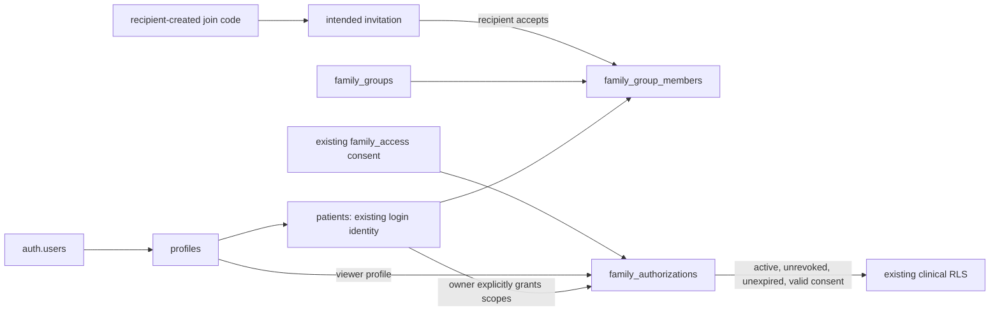

# EasyCare Phase 2 — Family / Dependent Foundation Report

2026-10-03, Asia/Rangoon. Adult-account foundation implemented. No dependent clinical identity was forced into the existing authenticated-patient model. No Phase 3 work or deployment was performed.

## 1. Files changed in this task

- src/App.jsx: authenticated /family route.
- src/components/Sidebar.jsx: existing navigation icon mapping.
- src/data/navigation.js: My Family navigation item.
- src/features/secondary/PatientSettingsPage.jsx: Manage My Family link, reachable through existing mobile Profile navigation.
- src/styles/global.css: family-specific styles using existing EasyCare design.

Existing unrelated tracked/untracked changes, Phase 1 files, historical migrations, security repairs, AI functions and medication code were preserved.

## 2. Files created

- supabase/migrations/20261003090000_family_foundation.sql
- src/services/repositories/familyRepository.js
- src/services/familyService.js
- src/services/familyService.test.js
- src/features/family/FamilyPage.jsx
- src/features/family/FamilyPage.test.jsx
- src/lib/familyFoundation.integration.test.js
- docs/EASYCARE_PHASE2_FAMILY_FOUNDATION_REPORT.md

## 3. Migration

One forward-only migration: 20261003090000_family_foundation.sql. No historical migration edits, destructive reset, legacy seed, hosted reset or deployment.

## 4. Added tables and final membership model

- family_groups: display_name, created_by profile, created_at, updated_at.
- family_group_members: group, existing authenticated patient, relationship, owner/member management role, active/removed status, added_by, created/joined/removed timestamps. Unique group/patient; at most one owner per group. Owner remains active and cannot be removed through member operations.
- family_join_codes: recipient profile, SHA-256 digest of a random one-use UUID code, creation/expiry/consumption timestamps. The raw code is returned only to its creator, never stored. New code generation invalidates earlier unused codes.
- family_invitations: group, intended recipient profile, inviter, relationship, pending/accepted/declined/cancelled state, timestamps and expiry.

Authenticated patients remain the only supported member identity. Relationships describe kinship relative to the group creator and do not encode permission. Guardian/child metadata can describe an adult account relationship; it creates no legal guardianship or non-login dependent identity. No manager role was added because the implemented operations need only owner and member.

Family owners can create groups, invite, cancel their invitations and remove non-owner members. Members can accept/decline invitations and leave. Every member controls only grants concerning their own patient data; the owner cannot grant access to other members' data.

Limits: 20 family groups per patient, 50 active members per group and 50 current pending invitations per group. Read APIs return up to 20 groups, 50 members and 100 most recent incoming/outgoing invitations. These are bounded management views, not a clinical aggregation API.

## 5. Existing tables extended

family_authorizations retains its existing patient/profile identity, unique pair, status enum, authorized_at, revoked_at and permission booleans. Added:

- expires_at: nullable for compatibility with historical grants; mandatory for new group-origin grants.
- revoked_by: profile reference for explicit revocation attribution.
- source_family_group_id: provenance used to revoke only the relevant group-origin grants when a member leaves/is removed.
- consent_id: the specific existing family_access consent recorded for this grant.

Lifecycle constraints reject infinite expiry, inconsistent revoker/status combinations and incomplete group-origin grant metadata. New group-origin expiry must follow authorized_at. Supporting FK indexes were added.

consents has no new columns or consent types. Added unique(id,patient_id) and a composite family_authorizations(consent_id,patient_id) FK to ensure a foreign patient's consent cannot authorize a grant. Existing consents and family_authorizations are preserved; there is no destructive backfill.

patients/profiles identity and existing clinical FKs were not altered.

## 6. Functions / RPCs

Added 11 browser RPCs:

- create_family_group(text)
- create_family_join_code()
- invite_family_member(uuid,text,text)
- respond_family_invitation(uuid,boolean)
- cancel_family_invitation(uuid)
- grant_family_authorization(uuid,jsonb,timestamptz)
- revoke_family_authorization(uuid)
- remove_family_member(uuid)
- get_my_family_groups()
- get_my_family_invitations()
- get_family_members(uuid)

Added two helpers: require_family_patient() and is_family_group_member(uuid). The first is internal and has no browser/PUBLIC/anon execution grant. The second returns only whether the current actor is an active member of the given group, for RLS. Family mutations and sanitized views require an active patient/profile and a recorded adult birth date. This uses current account data and is not independent age verification.

Updated can_access_patient(uuid,text) with the smallest family-branch lifecycle extension: status active, no revoked_at, future-or-null expires_at, and a granted matching consent when consent_id is populated. Its original own-patient, administrator, provider, coordinator, clinic-admin and clinical identity branches remain unchanged. The tests compare the provider branch and provider helper against the pre-migration catalog.

All SECURITY DEFINER functions have an explicit empty search_path and schema-qualified application objects. Browser RPCs deny PUBLIC/anon execution and are granted to authenticated only. Functions resolve the caller's own patient server-side using auth.uid(). APIs accept group, invitation, membership or authorization identifiers, never an arbitrary clinical patient/profile selection.

## 7. RLS, grants and auditability

All four new tables enable RLS.

- family_groups_read: current active group membership.
- family_members_read: current active group membership.
- family_codes_read: creator only; authenticated SELECT is deliberately not granted, so clients cannot retrieve stored code digests.
- family_invites_read: intended recipient or original inviter only.

Authenticated direct INSERT/UPDATE/DELETE is denied on all new tables. Direct authenticated family_authorizations mutations are also revoked; clinical permission changes use the scoped RPCs. Existing clinical policies and provider helpers are preserved. Existing authorized SELECT semantics on family_authorizations remain unchanged.

Reuse of audit_row_change records group, membership and invitation mutations. The existing family_authorizations audit trigger records grant, scope/expiry change and revocation with actor and before/after data. Consent rows are linked to the audited authorization; no separate event platform was created.

Mutations lock the family group for acceptance, grant and member removal; invitation and code rows are locked before consumption. Membership removal is soft. All new parent links use RESTRICT; removal updates metadata/grants/consents and never deletes appointments or clinical history.

## 8. Membership, clinical authorization and consent are separate

There is no membership-to-clinical-access edge. A member's name is shared with the family only after acceptance. Read views expose management metadata and the caller's outgoing grant information, not other members' clinical facts.

Permission scopes reuse records, appointments, medications, payments and alerts flags. The records flag retains the existing broad can_view_records semantics across tables using view/clinical checks; it is not a new granular per-lab/per-vital permission system. All unselected flags, including alerts, are explicitly false on a new grant. Existing table/RPC restrictions continue to apply: flags do not bypass own-only medication confirmation, AI generation or absent cancel/reschedule APIs.

## 9. Authorization lifecycle

A grant is made by the data-owning patient, for an active member of one of their families, with explicit boolean scopes and an expiry within one year. New consent uses existing consent_type family_access and version family-foundation-v1. Updating/re-granting withdraws the preceding linked consent and records a new consent.

Revocation sets status=revoked, revoked_at and revoked_by, and withdraws the linked consent. Expiry denies access immediately in can_access_patient without waiting for a worker. Pending authorizations do not grant access. Withdrawal of a linked consent also denies access; the management view reports inactive. Expired invitations/authorizations are derived display states rather than new enum values.

Leaving/removal revokes group-origin grants involving the removed member, withdraws their linked consents and cancels pending invitations for them in that group. Unrelated historical delegations are retained. Historical grants with NULL expiry/consent/source group keep their previous semantics until the patient changes or revokes them; they are not silently given a new lifetime or household provenance. A legacy grant's manually supplied past expires_at is still denied by the updated helper.

No consent row is presented as evidence of legal compliance or legal guardianship.

## 10. Invitation lifecycle and privacy

1. The intended adult user generates a 24-hour invitation code while signed in.
2. They share the raw code with the family owner through a trusted channel outside EasyCare.
3. The owner submits that code and relationship; the server resolves its bound creator, consumes it once and creates a seven-day invitation.
4. Only that intended signed-in account can accept/decline. The owner can cancel a pending invitation.
5. Acceptance activates membership and shares the real recorded member name with the family. It creates no clinical authorization or family-access consent.

No patient lookup/search by name, UUID, phone or email was added. There is no invitation delivery worker or messaging integration. Unknown/consumed/expired code handling is generic and returns no account/clinical information. Public/unauthorized invitation enumeration is denied. Application error messages do not forward raw database details.

## 11. Dependent gate: blocker and concrete design proposal

Non-login dependents were NOT implemented. The permitted safe adult-only fallback was chosen.

Trace findings:

- The existing 27 tables with direct patient FK references include ai_health_summaries, ai_interactions, ai_overview_leases, ai_overview_request_limits, appointments, audit_logs, care_encounters, care_requests, clinical_documents, complaints, consents, family_authorizations, follow_ups, lab_orders, lab_results, medical_history_items, medication_events, monitoring_alerts, notifications, patient_allergies, patient_conditions, patient_health_profiles, patient_medications, payments, prescriptions, subscriptions and vital_readings. Repair composite chains add further patient-bound parent relationships.
- patients.auth_user_id and profile_id are NOT NULL, unique, FK-linked and equality-bound; profiles.id references auth.users. A row without a login cannot be inserted while preserving this contract.
- Service-only registration creates the Auth-linked profile/patient/consents, not a managed-subject identity.
- AuthContext/authService resolves an active own patient by auth_user_id. Phase 1 keeps this identity and already-authorized props; it was not changed to select members.
- can_access_patient resolves own and delegated access against this same patient/profile identity, with frozen provider restrictions.
- AI Overview Edge authorization additionally requires patient.profile_id equal to the caller; it was not changed.
- record_medication_event_status requires the own patient profile and valid event/schedule/medication chain; it was not changed.
- Appointment, encounter, lab, prescription, vital, alert, document and medication integrity depend on existing clinical patients and repaired composite relationships. A standalone dependent metadata table could not participate in those chains and would falsely imply clinical support.

Proposed separately approved extension: introduce a clinical_subjects registry independent of login; link existing authenticated patients one-to-one to their subject without weakening their identity columns; give managed dependents their own subject and explicit guardian/delegation lifecycle; migrate clinical FK/composite chains to the subject identity while preserving existing patient IDs/data and review each affected RLS/RPC/AI/medication path. Login resolution stays in the authenticated patients model. Dependent/guardian metadata owns no clinical history, and removal revokes delegation without deleting the subject or records.

That is a broad clinical-identity/security migration, not a small additive household change. It requires a dedicated schema/authorization design and repair regression review before implementation. No clinical_subjects or dependent placeholder tables, fake Auth users, fake emails or shared guardian logins were created here.

## 12. Repository/service APIs

familyRepository calls only the named Supabase RPCs; it never falls back to presentation fixtures. familyService validates names/codes and isolates groups/invitations with Promise.allSettled.

Implemented APIs: getMyFamilyGroups, getFamilyMembers, getMyFamilyInvitations, createFamilyGroup, createFamilyJoinCode, inviteFamilyMember, acceptFamilyInvitation, declineFamilyInvitation, cancelFamilyInvitation, removeFamilyMember, grantFamilyAuthorization, revokeFamilyAuthorization and loadMyFamilyManagement. Caller identity is inferred at the database, not supplied from React.

## 13. Frontend

Authenticated /family management page, native EasyCare AppShell/navigation/cards/forms/buttons/styles. Desktop sidebar and Settings link make it reachable on desktop and mobile. UI supports creating families, generating a code, inviting an adult, accepting/declining/cancelling, reading real connected members, removal/leaving, explicit permission/consent/expiry grants and revocation. Sections have loading/empty/error/success states; async results/private codes are discarded when Auth account identity changes.

There are no health cards, health statuses, clinical queries, member health selectors, family AI or family aggregations. Phase 1 and PatientHealthSections remain unchanged. Member display data is returned by the real database, not hardcoded runtime records.

## 14. Tests and migration replay

src/lib/familyFoundation.integration.test.js: 26 real PostgreSQL tests using the existing PGlite Auth/Storage harness. It replays all 44 historical migrations, captures existing identity constraints/FKs/policies/helpers and applies the forward migration, proving a complete 45-migration replay. Existing clinical catalog comparisons verify preservation, not just source-text assertions.

Coverage: own/unrelated family RLS, intended recipient, no permission on acceptance, selected scopes, revoked/expired/pending/withdrawn denial, wrong patient, foreign self-grant/revocation denial, forged/direct writes, unknown UUID/code attachment, hidden invitations/codes, code invalidation/expiry, declined/cancelled invitations, membership removal with preserved records, consent patient FK, audit events, legacy access, own access and provider suspension rules. No dependent tests claim unsupported functionality.

src/services/familyService.test.js: 4 tests for exact RPC contracts, no caller patient/profile arguments, section isolation, validation and sanitized errors.

src/features/family/FamilyPage.test.jsx: 12 tests for truthful state/rendering, server-generated code, actual members, invitation operations, separate access grant/consent/expiry, revocation/removal, errors, no clinical aggregation, prototype rejection and stale-account isolation.

The existing Security Repairs 1–15 integration suites remain unchanged and passed in the non-legacy run. The new full-chain tests additionally compare post-Phase-2 clinical constraints/policies/provider logic with the preceding schema.

## 15. Results

- Current non-legacy suite: 1,041 tests passed across 71 files, including all security repair tests and the 42 new family tests.
- Final form refinements: frontend/service tests passed (16 tests); isolated family database rerun passed (26 tests). One repeated combined run hit a 30-second migration setup hook timeout during a prolonged run; the subsequent isolated full-chain replay passed in under four seconds.
- Migration replay: all 45 migrations succeeded from zero, in local isolated PGlite only.
- Final production build: passed; existing Vite warning about the application bundle exceeding 500 kB remains.
- Source diff whitespace check: passed.
- No authenticated browser or hosted Supabase validation performed.

Excluded pre-existing failures, not passing tests: src/lib/bookableDoctorSeed.test.js, src/lib/phase4DatabaseSchema.test.js and src/lib/phase9AppointmentManagement.test.js reference removed historical migration files. .kilo worktree duplicates are excluded as documented in the prior handoffs.

## 16. Known limitations

- Adult authenticated accounts only; unknown/minor DOB accounts cannot use the new management RPCs. DOB is account data, not independent verification.
- No non-login dependents or legal guardian workflow.
- Manual code sharing/refresh; no invite delivery or notification worker.
- No family rename/delete, ownership transfer, manager role, clinical aggregation or health viewing page.
- Historical delegations remain independent of household membership and retain NULL lifecycle fields unless explicitly updated/revoked.
- Management views are bounded previews; invitation history beyond the latest 100 has no pagination UI.
- No hosted migration/grant/RLS/Edge audit and no live two-account browser journey. The migration must be applied separately before this new UI can use the RPCs; unavailable backend is reported honestly.
- No clinical family access facade or family-aware AI was added; these remain Phase 3 design work. Existing stored-summary delegated-read policies were preserved, not broadened, and own-patient AI generation remains enforced.

## 17. Phase 3 readiness and confirmations

Adult-account membership/consent/permission infrastructure is implemented and tested. Full planned Family Health Command Center readiness: NO.

Exact blocker: dependent clinical identity and guardian authorization must be designed and implemented compatibly with the existing 27 patient-referencing tables and repaired composite relationships. This is necessary for a genuine child/elderly dependent without a login to participate in the planned clinical experience. Phase 3 may be explicitly narrowed to existing adult accounts, but that scope decision was not made silently here.

Confirmed:

- Security Repairs 1–15 were not rewritten.
- Existing authenticated patient identity was preserved.
- Family membership alone does not grant clinical access.
- No arbitrary cross-patient access was introduced.
- No fake runtime family members were added.
- No Family Health Command Center was implemented.
- No AI family access feature/API or family-aware generation was enabled; existing AI authorization remains unchanged.
- No deployment was performed.

Is EasyCare ready to begin Phase 3 — Family Health Command Center? NO — the non-login dependent identity/guardian foundation remains blocked as described above. Stop after Phase 2; Phase 3 was not started.
